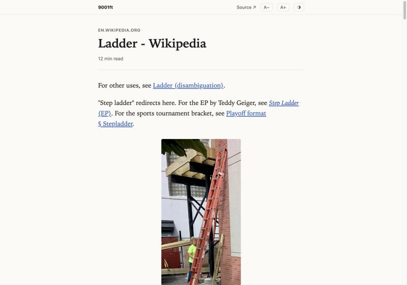

# 9001ft Ladder

A small reader you run on your own computer. Paste a link and get the page back without the clutter, or as a clean Reader view. Taller than 13 feet. Considerably.

9001ft Ladder is a fork of [wasi-master/13ft](https://github.com/wasi-master/13ft) (MIT). On top of what 13ft does, it adds:

- **Reader view.** Any page becomes a clean article: title, site, author, date, reading time, text and images, with light, dark and sepia themes and adjustable text size. The article's wording is never changed.
- **Send to Reader bookmarklet.** Click it on any page open in your own browser, including articles you subscribe to, and that page opens in Reader view exactly as your browser had it.
- **archive.org pages that keep their look.** Pages loaded from the Wayback Machine keep their styles and images instead of arriving as bare text.

| Home | Reader view |
|---|---|
|  |  |

## Use it responsibly

9001ft is meant for one person, on their own computer. It listens only on `127.0.0.1` (this machine) by default. Keep it that way.

- **Best use:** tidying up pages you can already read. That means your own subscriptions (use the Send to Reader bookmarklet) and free articles buried under clutter.
- **Don't run it as a public website.** Anyone who can reach it can fetch any page through it, and publishers do go after public tools like this: the host of 12ft.io locked that site in July 2025 after a publisher complaint.
- **Pay for what you read regularly.** Writers need to eat too. Sometimes it's lasagna.

How you use it is your responsibility. In the US, the law on getting around access controls (17 U.S.C. §1201) and on copying (§106) can apply. This README isn't legal advice.

## Running it

### With Docker

```sh
git clone https://github.com/TheRealEminem/9001ft.git
cd 9001ft
docker compose up --build
```

Then open <http://localhost:5013>. Port 5013 rather than 5000, because macOS AirPlay Receiver uses 5000.

### With Python

Needs Python 3.9 or newer. From the top folder of the repo:

```sh
python3 -m venv venv
venv/bin/python -m pip install -r requirements.txt
venv/bin/python -m gunicorn --chdir app -b 127.0.0.1:5013 --threads 4 portable:app
```

Then open <http://localhost:5013>. Stop it with Ctrl+C.

## Using it

- **Paste a link** on the home page. Tick **Open in Reader view** to go straight to the clean version.
- **Put the link after the address:** `http://localhost:5013/https://example.com/some-article` (from [@atcasanova](https://github.com/atcasanova)).
- **Reader view directly:** `http://localhost:5013/reader/https://example.com/some-article`, or press the 📖 button on any page 9001ft fetched.

### Bookmarklets

Bookmarklets are bookmarks that run a little code on the page you're viewing. Drag the **📖 Send to 9001ft Reader** button from the home page to your bookmarks bar, or make bookmarks from these:

**Send to Reader** sends the page your browser is showing (with your own logins and subscriptions) to Reader view. Nothing is fetched again:

```javascript
javascript:(function(){var d=document.documentElement.cloneNode(true);d.querySelectorAll('script,style,svg,link,template').forEach(function(e){e.remove();});var f=document.createElement('form');f.method='post';f.action='http://localhost:5013/reader';f.target='_blank';f.enctype='multipart/form-data';f.acceptCharset='UTF-8';f.style.display='none';[['html','<!DOCTYPE html>'+d.outerHTML],['url',location.href]].forEach(function(p){var t=document.createElement('textarea');t.name=p[0];t.value=p[1];f.appendChild(t);});document.body.appendChild(f);f.submit();f.remove();})();
```

**Open in 9001ft** opens the current address through 9001ft (from [@barakplasma](https://github.com/barakplasma)):

```javascript
javascript:(function(){window.location.href="http://localhost:5013/"+encodeURIComponent(window.location.href);})();
```

A few sites block forms from sending data to other addresses (a `form-action` security policy). On those, Send to Reader does nothing; use the second bookmarklet instead.

## How it works

When you paste a link, 9001ft asks the site for the page the way Google's crawler does, since many sites give search engines the full text. Many large sites now check that such requests really come from Google, so when that fails it tries public copies: Freedium for Medium, then the Internet Archive's Wayback Machine, then archive.today. The status page shows each step. (Multi-source fallbacks from [@JRS1986](https://github.com/JRS1986).)

Public copies have limits. archive.today saves pages without any JavaScript, so animations and interactive graphics can't come back from there. archive.org keeps them, and 9001ft loads its copies of the page's styles, images and scripts. archive.org doesn't let other sites use its copies of fonts and CSS icons, so 9001ft passes stylesheets, fonts and icons through a small relay on your own server that adds the permission browsers need. The relay only fetches from archive.org.

Reader view uses [readability](https://github.com/buriy/python-readability) to find the article in the page, then strips everything else: scripts, styles, event handlers and tracking. It's served with a strict Content Security Policy, so nothing from the article can run code on your machine.

## Languages

Set `LOCALE` before starting to change the interface language: `de`, `en` (default), `es`, `eu`, `fr`, `it`, `ja`, `ko`, `pt`, `ru` or `zh`.

```sh
LOCALE=de venv/bin/python -m gunicorn --chdir app -b 127.0.0.1:5013 portable:app
```

To add a language, copy `app/locales/en.json` to `app/locales/<code>.json` and translate the values. Keys you leave out fall back to English.

## Tests

```sh
venv/bin/python -m pip install pytest
venv/bin/python -m pytest -q
```

The tests run offline: Flask's test client stands in for the browser, and every outside request is mocked. They cover the routes, error handling, languages, HTML processing, archive.org rewriting, Reader view extraction and sanitizing, the bookmarklet endpoint, caching, archive fallbacks and the progress stream. GitHub Actions runs them on every push and pull request (`.github/workflows/test.yml`).

## Credits

9001ft Ladder is built on [13ft](https://github.com/wasi-master/13ft) by Arian Mollik Wasi and its contributors, under the MIT license. 13ft logo by [@mcmikemn](https://github.com/mcmikemn).
