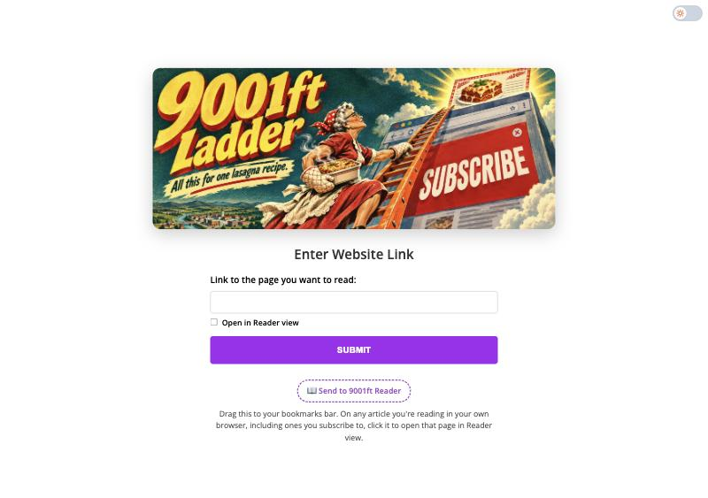

# 9001ft Ladder

A small reader you run on your own computer. Paste a link and get the page back without the clutter, or as a clean Reader view. Taller than 13 feet. Considerably.

9001ft Ladder is a fork of [wasi-master/13ft](https://github.com/wasi-master/13ft) (MIT). On top of what 13ft does, it adds:

- **Reader view.** Any page becomes a clean article: title, site, author, date, reading time, text and images, with light, dark and sepia themes and adjustable text size. It can read the article aloud and export it as Markdown, an EPUB e-book or a PDF. The article's wording is never changed.
- **Send to Reader bookmarklet.** Click it on any page open in your own browser, including articles you subscribe to, and that page opens in Reader view exactly as your browser had it.
- **Your library.** Press **📌 Keep a copy** to save a page on your computer with its styles, images, fonts and scripts, plus a Reader version, to read later, even offline.
- **AI tidy (optional).** When an article comes out messy, one click asks an AI model how it should be laid out: headings, lists, paragraphs that were split apart, clutter to leave out. The model never writes text; the page is rebuilt from the original words, and a check confirms nothing was reworded.
- **archive.org pages that keep their look.** Pages loaded from the Wayback Machine keep their styles and images instead of arriving as bare text.

| Home | Reader view |
|---|---|
|  |  |

## Use it responsibly

9001ft is meant for one person, on their own computer. It listens only on `127.0.0.1` (this machine) by default. Keep it that way.

- **Best use:** tidying up pages you can already read. That means your own subscriptions (use the Send to Reader bookmarklet) and free articles buried under clutter.
- **Don't run it as a public website.** Anyone who can reach it can fetch any page through it, and publishers do go after public tools like this: the host of 12ft.io locked that site in July 2025 after a publisher complaint.
- **Pay for what you read regularly.** Writers need to eat too. Sometimes it's lasagna.

How you use it is your responsibility. In the US, the law on getting around access controls (17 U.S.C. §1201) and on copying (§106) can apply. This README isn't legal advice.

## Running it

### With Docker

```sh
git clone https://github.com/TheRealEminem/9001ft.git
cd 9001ft
docker compose up --build
```

Then open <http://localhost:5013>. Port 5013 rather than 5000, because macOS AirPlay Receiver uses 5000.

### With Python

Needs Python 3.9 or newer. From the top folder of the repo:

```sh
python3 -m venv venv
venv/bin/python -m pip install -r requirements.txt
venv/bin/python -m gunicorn --chdir app -b 127.0.0.1:5013 --threads 4 portable:app
```

Then open <http://localhost:5013>. Stop it with Ctrl+C.

## Using it

- **Paste a link** on the home page. Tick **Open in Reader view** to go straight to the clean version.
- **Put the link after the address:** `http://localhost:5013/https://example.com/some-article` (from [@atcasanova](https://github.com/atcasanova)).
- **Reader view directly:** `http://localhost:5013/reader/https://example.com/some-article`, or press the 📖 button on any page 9001ft fetched.

### Listening and keeping a copy

- **🔊 Read aloud.** Reads the article with your browser's built-in voices, so nothing goes over the network. Play, pause, stop, a speed from 0.8× to 2×, and a voice picker (it starts with a voice for the article's language). The paragraph being read is highlighted and kept in view. Reading stops when you leave the page. The button only appears in browsers that can speak.
- **Export.** Download the article as **Markdown** (`.md`, with the title, source link, author and date at the top) or as an **e-book** (`.epub`, opens in Apple Books, Calibre and most e-readers; images become links), or use **Print or save as PDF** for a clean printout without the toolbar. Exports use the article as it's shown, so a tidied article exports tidied. Like AI tidy, the export button answers only at `localhost` (see `LADDER_ALLOWED_HOSTS` below).

### Bookmarklets

Bookmarklets are bookmarks that run a little code on the page you're viewing. Drag the **📖 Send to 9001ft Reader** button from the home page to your bookmarks bar, or make bookmarks from these:

**Send to Reader** sends the page your browser is showing (with your own logins and subscriptions) to Reader view. Nothing is fetched again:

```javascript
javascript:(function(){var d=document.documentElement.cloneNode(true);d.querySelectorAll('script,style,svg,link,template').forEach(function(e){e.remove();});var f=document.createElement('form');f.method='post';f.action='http://localhost:5013/reader';f.target='_blank';f.enctype='multipart/form-data';f.acceptCharset='UTF-8';f.style.display='none';[['html','<!DOCTYPE html>'+d.outerHTML],['url',location.href]].forEach(function(p){var t=document.createElement('textarea');t.name=p[0];t.value=p[1];f.appendChild(t);});document.body.appendChild(f);f.submit();f.remove();})();
```

**Open in 9001ft** opens the current address through 9001ft (from [@barakplasma](https://github.com/barakplasma)):

```javascript
javascript:(function(){window.location.href="http://localhost:5013/"+encodeURIComponent(window.location.href);})();
```

**Keep a copy in 9001ft** sends the whole page your browser is showing, styles and scripts included, to your library (see below). It's on the library page, ready to drag:

```javascript
javascript:(function(){var d=document.documentElement.cloneNode(true),s=document.querySelectorAll('style'),c=d.querySelectorAll('style');for(var i=0;i<s.length&&i<c.length;i++){if(!c[i].textContent.trim()){try{c[i].textContent=Array.prototype.map.call(s[i].sheet.cssRules,function(r){return r.cssText;}).join(' ');}catch(e){}}}var t=document.doctype?'<!DOCTYPE '+document.doctype.name+'>':'';var f=document.createElement('form');f.method='post';f.action='http://localhost:5013/library/keep';f.target='_blank';f.enctype='multipart/form-data';f.acceptCharset='UTF-8';f.style.display='none';[['html',t+d.outerHTML],['url',location.href]].forEach(function(p){var e=document.createElement('textarea');e.name=p[0];e.value=p[1];f.appendChild(e);});document.body.appendChild(f);f.submit();f.remove();})();
```

A few sites block forms from sending data to other addresses (a `form-action` security policy). On those, Send to Reader and Keep a copy do nothing; use Open in 9001ft instead.

## Your library

Press **📌 Keep a copy** on any page 9001ft opened (next to the 📖 button), in Reader view, or with the **Keep a copy in 9001ft** bookmarklet on a page in your own browser. A confirmation page shows what will be saved; nothing is kept until you press the button there.

9001ft then saves the page together with everything it uses: stylesheets (and the fonts, images and stylesheets they load), images in every size the page offers, fonts, scripts and video posters, all rewritten to point at the local copies, so the page opens offline looking as it did, animations included where its scripts allow. Videos, frames and links still point at the live site. It also saves the Reader version (title, site, author, date, reading time and text, with the saved images), which works offline too.

Open **📚 Your library** from the home page (`http://localhost:5013/library`). Each copy shows its title, site, the date you kept it and its size, with buttons to open the copy, open the Reader version, open the live page, or delete it (it asks first).

- Copies are saved in `data/library/` (or under `LADDER_DATA_DIR`), readable only by your user. Each is capped at 50 MB, and any one file at 15 MB. Files that fail, are too big or aren't what the page said they were are skipped, and the library lists which ones and why.
- Pages that used a public copy from archive.org are kept with the archived styles and images.
- The files a page uses are downloaded by your own server, which only fetches from the public internet: it refuses addresses on your own network (private, loopback and link-local), checks again after every redirect, and checks the address it actually connected to.
- A kept page still has its own scripts, so it opens sandboxed, just like pages 9001ft fetches: its scripts can't reach your settings or your other copies. Only a 9001ft page can save or delete copies; other sites can at most bring up the confirmation page.

## AI tidy (optional)

When a page comes out jumbled (archived copies often do), press **✨ Tidy up** in Reader view. The button appears once you've chosen an AI (below).

How it stays faithful: the article is split into numbered blocks, and the model answers only with a plan (block 4 is a heading, blocks 7 and 8 are one paragraph, block 12 is an ad). 9001ft rebuilds the page from the original blocks, so the model can't add or change a word. It can leave out short clutter blocks, capped at 60 words each and a quarter of the article. A final check compares the words before and after, and **Show original** switches back at any time.

### Choosing the AI

Open **⚙️ AI settings** from the home page (`http://localhost:5013/settings`) and pick one:

- **Off.**
- **Local model with Ollama.** Runs on your own computer, so nothing leaves it. Pick from the models you've downloaded (sizes are shown); a small one such as `qwen3.5:4b` suits a laptop. Thinking is off by default, which is much faster.
- **Your own API key.** Anthropic Claude, OpenAI, Google Gemini, OpenRouter, Groq, Mistral, DeepSeek, xAI, Together, or any other OpenAI-compatible address (a LiteLLM router, LM Studio, …). **Load list** asks the provider which models your key can use. You can also tick **use my local model** as a fallback for when the service can't be reached.

**Test AI** sends a one-word request to check the setup. Settings are saved in `data/settings.json` (git ignores it, and only your user can read it). API keys never go back to the browser. When you press Tidy up, the article's text goes to the service you chose; nothing is sent before that.

The settings page and AI tidy only answer at `localhost`, from 9001ft's own pages. To use them under another hostname on your own network, list it in `LADDER_ALLOWED_HOSTS` (comma-separated).

<details>
<summary>Setting it up with environment variables instead</summary>

When nothing is saved on the settings page, 9001ft reads these from the environment or from a `.env.local` file in the top folder (git ignores it):

```sh
TIDY_API_BASE=http://localhost:11434/v1     # any OpenAI-compatible API
TIDY_MODEL=qwen3.5:4b
TIDY_API_KEY=...                            # or TIDY_API_KEY_FILE=~/path/to/key-file
TIDY_REASONING_EFFORT=none                  # optional: "none" stops a thinking model thinking
TIDY_FALLBACK_API_BASE=...                  # optional second service, tried when the first can't be reached
TIDY_FALLBACK_MODEL=...                     # (and _API_KEY, _API_KEY_FILE, _REASONING_EFFORT)
```

`LADDER_DATA_DIR` changes where the settings page saves (default: `data/`). With Docker, `docker-compose.yaml` keeps it in `./data`, and a model on your computer is at `http://host.docker.internal:11434/v1`.
</details>

## How it works

When you paste a link, 9001ft asks the site for the page the way Google's crawler does, since many sites give search engines the full text. Many large sites now check that such requests really come from Google, so when that fails it tries public copies: Freedium for Medium, then the Internet Archive's Wayback Machine, then archive.today. The status page shows each step. (Multi-source fallbacks from [@JRS1986](https://github.com/JRS1986).)

Public copies have limits. archive.today saves pages without any JavaScript, so animations and interactive graphics can't come back from there. archive.org keeps them, and 9001ft loads its copies of the page's styles, images and scripts. archive.org doesn't let other sites use its copies of fonts and CSS icons, so 9001ft passes stylesheets, fonts and icons through a small relay on your own server that adds the permission browsers need. The relay only fetches from archive.org.

Reader view uses [readability](https://github.com/buriy/python-readability) to find the article in the page, then strips everything else: scripts, styles, event handlers and tracking. It's served with a strict Content Security Policy, so nothing from the article can run code on your machine.

## Languages

Set `LOCALE` before starting to change the interface language: `de`, `en` (default), `es`, `eu`, `fr`, `it`, `ja`, `ko`, `pt`, `ru` or `zh`.

```sh
LOCALE=de venv/bin/python -m gunicorn --chdir app -b 127.0.0.1:5013 portable:app
```

To add a language, copy `app/locales/en.json` to `app/locales/<code>.json` and translate the values. Keys you leave out fall back to English.

## Tests

```sh
venv/bin/python -m pip install pytest
venv/bin/python -m pytest -q
```

The tests run offline: Flask's test client stands in for the browser, and every outside request is mocked. They cover the routes, error handling, languages, HTML processing, archive.org rewriting, Reader view extraction and sanitizing, Markdown and EPUB export, AI tidy plans and their safety checks, the archive.org relay, the bookmarklet endpoints, the library (saving, sandboxing, address checks and size limits), caching, archive fallbacks and the progress stream. GitHub Actions runs them on every push and pull request (`.github/workflows/test.yml`).

## Credits

9001ft Ladder is built on [13ft](https://github.com/wasi-master/13ft) by Arian Mollik Wasi and its contributors, under the MIT license. 13ft logo by [@mcmikemn](https://github.com/mcmikemn).
